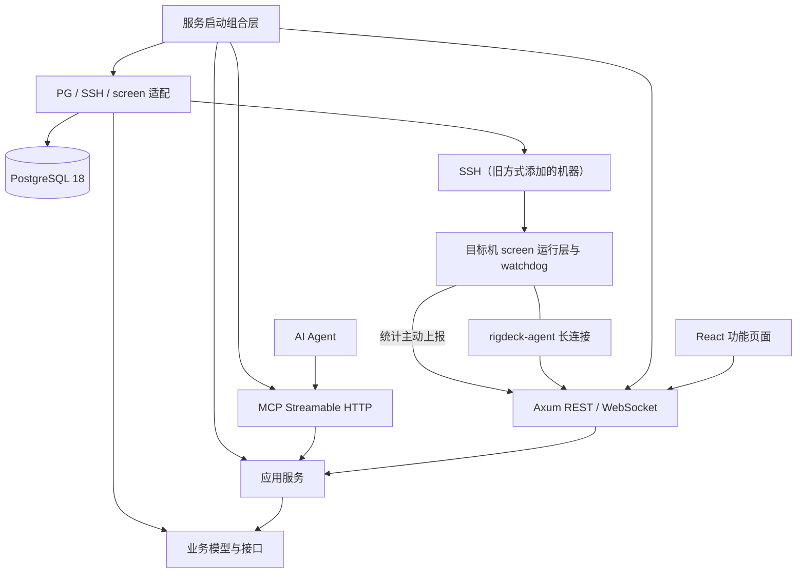

# 架构与模块边界

## 依赖方向

| Cargo crate | 内容 | 允许的内部依赖 |
|---|---|---|
| `rig-domain` | 数据模型、错误、Repository 和设备接口 | 无 |
| `rig-application` | identity、fleet、catalog、flights、mining、jobs、telemetry、push、agent、enroll、audit 应用服务 | domain |
| `rig-infrastructure` | 各模块 PG Repository、SSH、软件适配器、运行层与安装脚本、密码与加密 | domain、application |
| `rig-api` | HTTP、WebSocket、MCP、OpenAPI | domain、application |
| `rigdeck` | 环境配置、依赖组装、CLI、服务启动 | 上述模块 |

领域层没有 Axum、SQLx 或 SSH 具体依赖。传输入口调用应用方法，不能直接访问 Repository。Repository 在 domain 按 identity/fleet/catalog/flights/jobs/telemetry/audit 定义，基础设施在 `pg/` 下分别实现；应用组合层持有聚合接口。新增 SQL 写入放在所属模块，跨模块通过应用服务和持久化作业协调。

前端每个 `features/<feature>/index.tsx` 为公开入口。共享协议来自 `openapi.json` 生成的 `shared/schema.d.ts`，网络调用通过 `openapi-fetch`；共享 UI 和图表在 `shared/`。CI 的 `tests/check_boundaries.py` 检查 Cargo 依赖方向、传输层数据库访问及跨功能内部导入；这是静态边界保护，不替代代码审查。

## 数据和任务

`migrations/0001_core.sql` 是首次建库迁移。关系表保存身份、机器、币种、钱包、矿池、矿工、飞行表任务、作业及目标；外键和唯一约束阻止悬空引用。专用参数及能力有 schema_version 的 JSONB，钱包新币种在事务中创建。编辑使用 revision/version 检测冲突。

提交应用任务时固定机器 ID 和完整钱包、矿池、矿工包 SHA256、任务配置快照。`deployment_versions` 与任务 action 保存渲染结果，机器本地按配置哈希保存版本。软件包字节放磁盘，上传元数据写 PG。

领取任务在短事务内使用 `FOR UPDATE SKIP LOCKED`，全局短 advisory lock 协调领取和状态变更，`machine_locks` 确保同机管理写操作串行。所有符合条件的目标立即独立执行，不设每任务或全局机器并发上限，也不等待首台验证。显式包含主控的电源任务将其排在最后。

租约 60 秒、心跳 10 秒；SSH 等待期间不持有数据库事务。重复幂等键和相同输入返回原 job_id，不同输入返回冲突。租约过期只重新查询原 operation_id；未知结果保留机器锁，不盲目重发。完成、取消、人工对账与总任务汇总采用同一个短事务协调锁，防止并发完成导致总状态停留在 running。

PG 故障时不能提交新写操作，已有远端进程与 watchdog 继续；主控恢复后依据远端记录对账。

## 两种连接方式

`RemoteExecutor` 只有四个动作：执行命令、带输入执行、上传文件、终端。运行层、任务、对账都建立在它上面，所以机器走哪条连接对它们透明，`RoutedExecutor` 按机器的 `transport` 选择：

- `agent`（一键加入）：矿机执行 `curl …/agent/install.sh | sudo bash -s -- <安装密钥>`，`rig-miner enroll` 用安装密钥登记，`rigdeck-agent` 以 root 运行并保持一条 WebSocket（`/agent/v1/connect`）。连接时主控发随机 nonce，agent 用本机密钥回 HMAC。主控的 `AgentHub` 按机器保存连接，把请求编号发出、等待对应结果；连接断开时未回复的请求按"结果不明"处理，交给原有的按操作 ID 对账。主控不保存这类机器的 SSH 凭据。
- `ssh`（旧方式）：主控用保存的凭据和指纹连接矿机。

机器密钥和安装密钥都由主密钥按用途派生，不额外入库；安装密钥只能新增机器。识别同一台矿机用主板 UUID 和物理网卡 MAC 的摘要，重装系统后回到原记录。

## 本地运行层

主控经 SSH 或 agent 把脚本放到 `/opt/rigdeck/runtime/<hash>`，原子更新 `current`。命令入口为 `/usr/local/bin/rig-miner`，数据根目录 `/var/lib/rigdeck`。不用覆盖目标机已有的 `miner` 命令。

每实例使用一个独立 screen 会话（其中 `miner` 窗口运行 supervisor），便于单实例关闭和重新连接。运行脚本追踪 PID 和 `/proc` 启动身份；停止先持久化意图和 STOP 标记，再 Ctrl+C、等待、只终止自身进程组。watchdog 不恢复人工停止、维护、切换、预热和超出恢复预算的实例。

系统重启时先处理未完成切换：已提交操作按持久化记录确认；未提交且版本未被其他操作改变则恢复旧运行意图，再启动应运行的实例。发现不一致保留 unknown。systemd 仅启动恢复入口、watchdog 和 agent，不管理每个矿工；这两个常驻服务都是 `KillMode=process`，重启它们不会带走经由它们启动的矿工。

## 指标与权限

名义周期：系统/矿工 10 秒，软件发现 60 秒，硬件清单 1 小时。网络超时可能延长轮次，所有记录有采样时间与错误，前端对过期数据明确降级。

系统、矿工、软件和硬件统计由目标机 watchdog 主动推送（运行层 ≥ 0.4.0）：每 10 秒向 `<对外地址>/ingest/v1/push`（或 `RIGDECK_INGEST_BIND` 另开的局域网端口）发送 zlib 压缩、HMAC 签名的报文，首次完整、之后只发与上一次确认快照相比的变化；看门狗策略随回复下发。主控 25 秒内没收到某台机器的推送时，才回退到经 SSH 或 agent 读取它的快照文件，并顺带为支持推送的运行层配置推送地址。协议与安全约束见 `crates/application/src/push.rs` 和 [主动上报说明](2026-10-18_push-telemetry.md)。

主控每 10 秒评估一次每台矿机的在线状态并在状态变化时记一条通知：超过设定分钟数（默认 2）没有任何遥测为本地离线；本地正常但矿池持续（默认 10 分钟）看不到 worker 或算力为 0 为矿池离线。矿池只查 supportxmr、Kryptex、HashVault、Nanopool 的公开接口，其他矿池标为不支持检测。见 [离线检测与通知](2026-10-22_offline-alerts.md)。

原始指标按日分区保留 7 天，分钟聚合 90 天，任务输出 30 天，审计 180 天。分钟 CPU/内存百分比和功率计算均值，其余结构字段保留该分钟最近样本。跨算法算力不相加。

管理员使用 Argon2 密码、服务端会话、安全 Cookie、CSRF 和登录限速。SSH 凭据用 AES-256-GCM，密钥不在 PG；主机指纹必须核实。AI 令牌按要求为可撤销的管理员权限，无额外确认流程。终端连接每 15 秒重新校验身份。审计记录终端开启，不记录逐键输入；批量命令保存有上限的输出。
